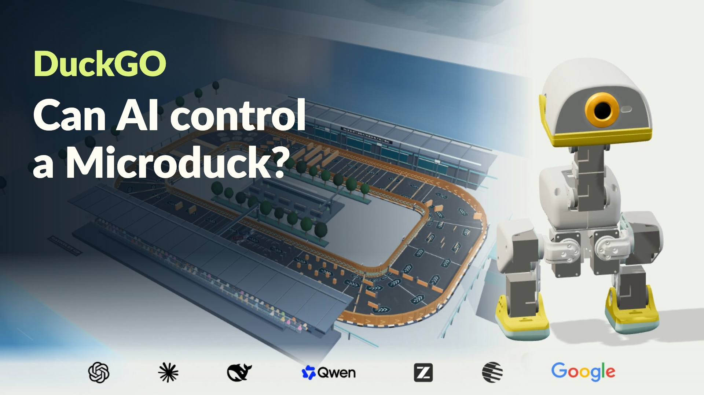

# DuckGO

English | [Chinese](README.zh-CN.md)

**Can a general-purpose agent guide a physically simulated robot through an entire obstacle race using only first-person visual observations?**

DuckGO studies an agent as the embodied decision-maker for Microduck, a biped robot in a MuJoCo obstacle course. The agent selects from available movement skills, observes what actually happened, and decides again. Skill outcomes are not guaranteed, and in real-time runs the environment continues to change while the agent thinks.

The course has 16 ordered stages, including narrow passages, moving gates, shifting barriers, low bars, and other obstacles. Results are organized by solo versus simultaneous races, with real-time and paused-inference settings kept separate.

## Explore DuckGO

- [Project website and results](http://43.156.246.20/showcase.html?lang=en)
- [Play on Hugging Face Spaces](https://huggingface.co/spaces/HandsomeWu666/DuckGO) — drive Microduck with a keyboard or Xbox controller. The Space currently requires access permission.

This repository is the public project landing page. Benchmark and agent code are not published here yet.

## Microduck projects and resources

- [Pollen Robotics · Microduck Sandbox](https://huggingface.co/spaces/pollen-robotics/microduck-simulator) — robot simulator.
- [Microduck Racer](https://huggingface.co/spaces/Nirav-Madhani/microduck-racer) — earlier Microduck racing environment.
- [microduck_rl](https://github.com/pollen-robotics/microduck_rl) — robot reinforcement-learning environments.
- [Microduck policies](https://huggingface.co/pollen-robotics/microduck-policies) — learned motion skills.
