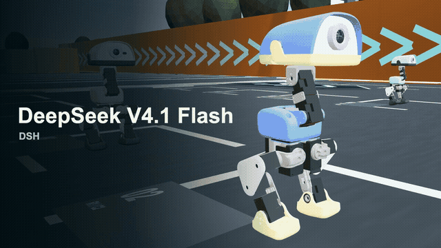

# DuckGO

English | [Chinese](README.zh-CN.md)

[Watch the full 70-second film](http://43.156.246.20/showcase/duckgo-benchmark-review-10.mp4)

**Can a general-purpose agent pilot a robot through an entire obstacle race?** We built DuckGO to test that question in MuJoCo. Each agent pilots a Microduck biped using the same motion skills. It reads the robot’s camera and state, chooses its next move and checks where the robot actually ended up. The gates keep swinging while the agent thinks.

To our knowledge, DuckGO is the first simulated obstacle race in which general-purpose agents use a shared set of motion skills to pilot robots head-to-head in real time. The course has 16 checkpoints. Solo runs show how far each agent can get on its own. We also started seven independent agents together in one shared world, where another robot can block the view or knock a competitor off course.

**What we found.** None of the 15 selected solo runs finished. GPT-6 Astra went furthest at 50.85% of the course. DeepSeek V4.1 Flash reached checkpoint 8 in 31:08, compared with 58:10 for Astra. Neither cleared checkpoint 9. Among four Claude Code configurations tested on V1, Fable 5.1 cleared six checkpoints and Opus 5.5 cleared two.

## Explore DuckGO

- [Project website and results](http://43.156.246.20/?lang=en)
- [Play on Hugging Face Spaces](https://huggingface.co/spaces/HandsomeWu666/DuckGO) — drive Microduck with a keyboard or Xbox controller. The Space currently requires access permission.

This repository is the public project landing page. Benchmark and agent code are not published here yet.

## Microduck projects and resources

- [Pollen Robotics · Microduck Sandbox](https://huggingface.co/spaces/pollen-robotics/microduck-simulator) — robot simulator.
- [Microduck Racer](https://huggingface.co/spaces/Nirav-Madhani/microduck-racer) — earlier Microduck racing environment.
- [microduck_rl](https://github.com/pollen-robotics/microduck_rl) — robot reinforcement-learning environments.
- [Microduck policies](https://huggingface.co/pollen-robotics/microduck-policies) — learned motion skills.
