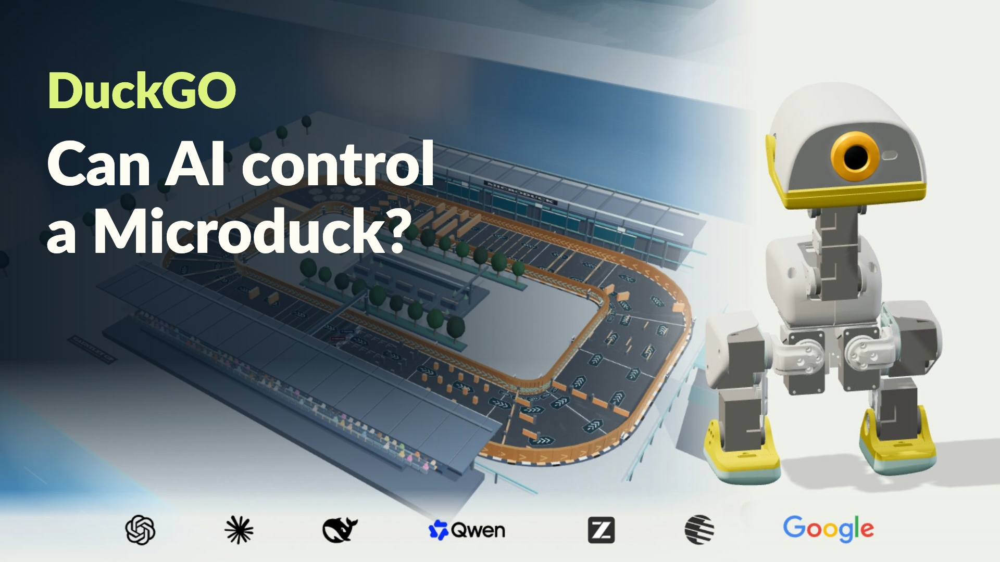

# DuckGO

[English](README.md) | 中文

**通用 Agent 能否仅凭第一视角画面，控制物理仿真的机器人完成整场障碍赛？**

DuckGO 将 Agent 作为双足机器人 Microduck 的具身决策者，在 MuJoCo 障碍赛道中评估其控制能力。Agent 从可用的运动技能中选择动作，观察实际执行结果，再继续决策。技能执行不保证成功；在实时模式下，Agent 思考时环境仍会变化。

赛道包含 16 个有序关卡，涵盖狭窄通道、摆门、横移挡板、低矮横杆等障碍。成绩将单鸭与多鸭同场、实时与推理暂停模式分别展示。

## 体验 DuckGO

- [项目网站与成绩](http://43.156.246.20/showcase.html?lang=zh)
- [Hugging Face Space 人工体验](https://huggingface.co/spaces/HandsomeWu666/DuckGO)：可用键盘或 Xbox 手柄控制 Microduck。目前需访问权限。

本仓库目前只公开项目介绍与封面，尚未公开基准测试和 Agent 代码。

## Microduck 相关项目与资源

- [Pollen Robotics · Microduck Sandbox](https://huggingface.co/spaces/pollen-robotics/microduck-simulator)：机器人仿真器。
- [Microduck Racer](https://huggingface.co/spaces/Nirav-Madhani/microduck-racer)：较早的 Microduck 竞赛环境。
- [microduck_rl](https://github.com/pollen-robotics/microduck_rl)：机器人强化学习环境。
- [Microduck policies](https://huggingface.co/pollen-robotics/microduck-policies)：训练得到的运动技能。
